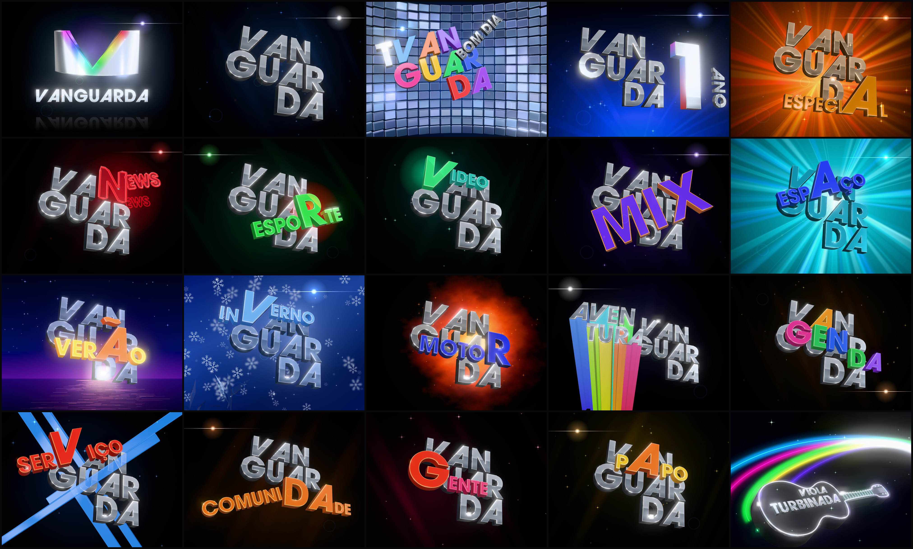

# Grafismo Rede Vanguarda — Redesign 2004



Redesign em 3D do grafismo antigo da Rede Vanguarda e das vinhetas dos seus programas.
O painel tem a mesma grade 5×4 e a mesma ordem da imagem de referência, em versão 2004:
cromo com linha de horizonte, letras laqueadas, fachos de luz, *bloom* e *lens flare*.

| Arquivo | Conteúdo |
| --- | --- |
| `vanguarda_grafismo_2004.png` | Painel completo, 4048×2440 (sem perdas) |
| `vanguarda_grafismo_2004.jpg` | Mesmo painel em JPG (mais leve para compartilhar) |
| `quadros/` | Os 20 quadros separados, 1600×1200 (4:3) |
| `src/` | Código que gera tudo (three.js + Chromium headless) |

## Quadros

| | 1 | 2 | 3 | 4 | 5 |
| --- | --- | --- | --- | --- | --- |
| **1** | Institucional | Vanguarda | Bom Dia Vanguarda | Vanguarda 1 Ano | Vanguarda Especial |
| **2** | Vanguarda News | Vanguarda Esporte | Vídeo Vanguarda | Vanguarda Mix | Espaço Vanguarda |
| **3** | Verão Vanguarda | Inverno Vanguarda | Vanguarda Motor | Aventura Vanguarda | Agenda Vanguarda |
| **4** | Serviço Vanguarda | Vanguarda Comunidade | Vanguarda Gente | Papo Vanguarda | Viola Turbinada |

## Tipografia

ITC Avant Garde Gothic Std (Bold e Demi), com os glifos alternativos do projeto aplicados a
todo **V** e **A**:

- `U+E04F` → V inclinado (`V.alt02`)
- `U+E000` → A inclinado (`A.alt01`)

As fontes são comerciais e **não** estão no repositório. Para renderizar de novo, copie-as
para `src/fonts/` (veja `src/fonts/LEIA-ME.txt`).

## Como renderizar

```bash
cd src
npm install                 # three.js + playwright
npx playwright install chromium   # se ainda não tiver o Chromium do Playwright
node render.mjs             # gera out/tile_00..19.png em 1600x1200
python3 compose.py out ../vanguarda_grafismo_2004.png 800   # monta o painel (requer Pillow)
```

- `node render.mjs 4 12` renderiza só os quadros 4 e 12.
- `W=800 H=600 node render.mjs` faz uma prévia rápida.

Cada quadro é uma função em `src/tiles.js`. O núcleo (`src/core.js`) cuida da extrusão das
letras, dos materiais cromados, do mapa de ambiente HDR procedural e do pós-processamento.
